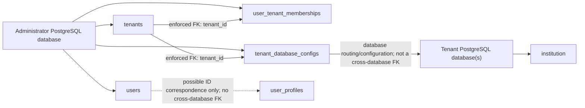

# Database architecture and ER diagrams

## Architecture

The application configures two independent PostgreSQL databases and generates a
separate Prisma client for each:

- **Administrator database** — configured by `prisma.config.ts`, using
  `prisma/admin/schema.prisma`. It stores users, tenants, tenant membership,
  refresh sessions, and tenant database configuration.
- **Tenant database** — configured by `prisma.tenant.config.ts`, using
  `prisma/tenant/schema.prisma`. Each tenant database has the tenant-scoped
  institution, identity/RBAC, academic, student, teacher, attendance, and audit
  data.

There is no root `prisma/schema.prisma` in this repository. The schema fragments
under `prisma/schemas/` are not selected by either Prisma configuration and are
not the source for these diagrams.

## Diagram index

| Diagram | Contents |
| --- | --- |
| [Administrator database](./admin-erd.mmd) | All administrator database models and enforced relationships |
| [Tenant identity and RBAC](./tenant-identity-erd.mmd) | User profiles, roles, permissions, and their join tables |
| [Tenant academic structure](./tenant-academic-erd.mmd) | Academic years, classes, sections, subjects, teachers, and assignments |
| [Tenant students and enrollments](./tenant-student-erd.mmd) | Students, guardians, enrollments, and admission serials |
| [Tenant teachers and attendance](./tenant-attendance-erd.mmd) | Teacher assignments, attendance, and their academic/student dependencies |
| [Complete tenant ERD](./tenant-full-erd.mmd) | Every model in the configured tenant schema |

## Reading the diagrams

Entity names are physical table names (`@@map` where declared); attributes use
database column names (`@map` where declared) and Prisma scalar types. `PK`,
`FK`, and `UK` mark primary keys, declared foreign keys, and unique fields.
Composite primary/unique constraints are identified in diagram comments with
their exact field sets. Relationship lines represent Prisma `@relation`
declarations only. Crow's-foot ends indicate the model cardinalities; optional
foreign keys use an optional end. Nullable scalar attributes are listed in
diagram comments because Mermaid ER attributes do not encode nullability.

The two databases cannot enforce ordinary relational foreign keys between
themselves. The following tenant fields are scalar UUIDs without a declared
Prisma relation and are therefore **not** drawn as foreign-key relationships:

- `user_profiles.user_id` is a logical user identifier; the schema does not
  declare that it references administrator `users.id`.
- `teachers.user_id` may identify a tenant user profile, but has no declared
  FK to `user_profiles.id`.
- `attendance_sessions.created_by_user_id` and `audit_logs.actor_user_id` may
  identify tenant user profiles, but have no declared FK.
- `attendance_sessions.academic_year_id` is stored as a scalar and has no
  declared FK to `academic_years.id`.
- `audit_logs.entity_id` is a generic optional entity identifier and has no
  declared FK.

The administrator schema has user-tenant membership, but the configured tenant
schema has no campus model or institution-membership model. `institution` is a
standalone tenant table with no declared relations.

These diagrams were derived by read-only inspection of the schemas and Prisma
configuration. No databases or production services were accessed.
